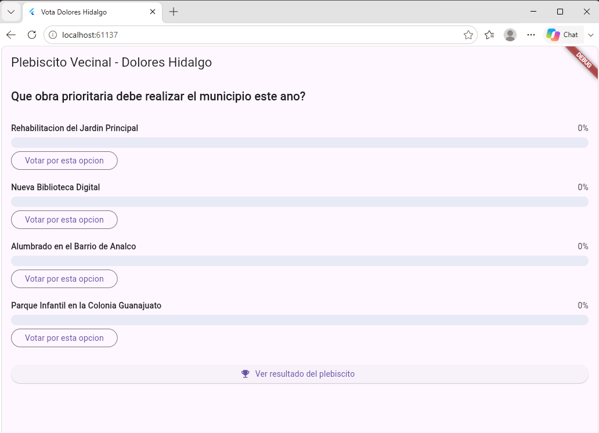
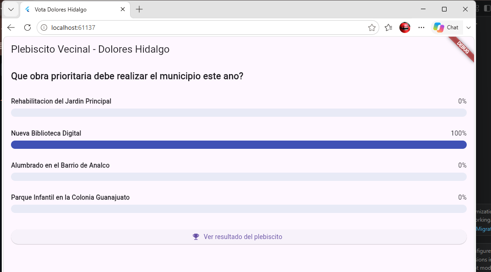
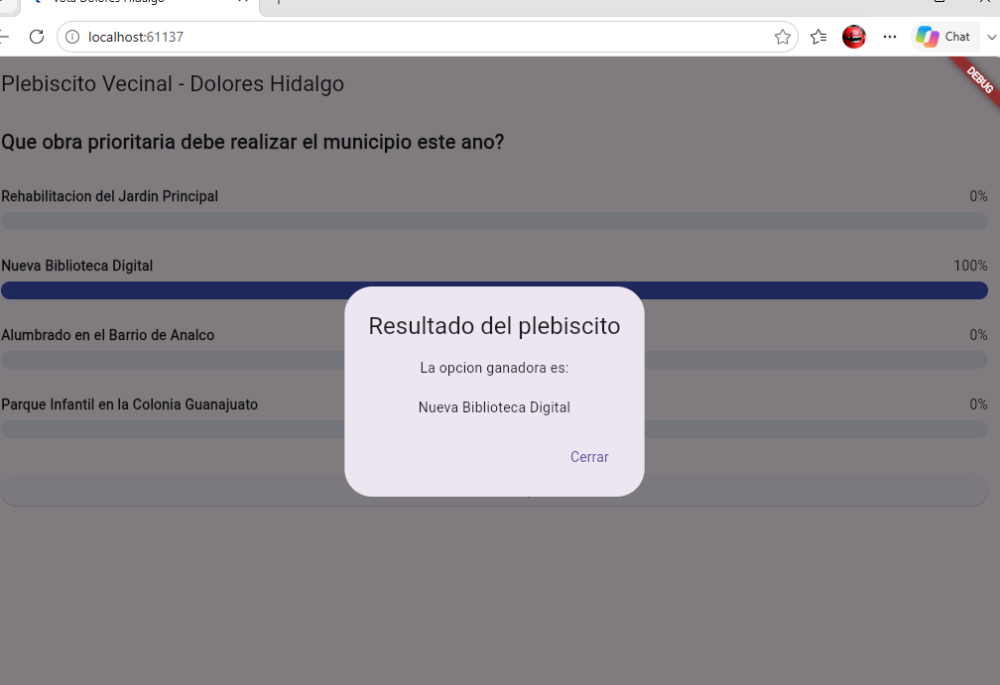
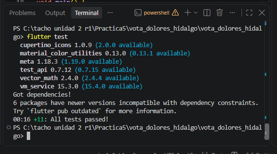

# Práctica 5 · Plebiscito Vecinal de Dolores Hidalgo

App de votación en Flutter. Los vecinos votan por la obra prioritaria del municipio, las barras de porcentaje se animan en pantalla y un diálogo anuncia la opción ganadora.

- **Alumno:** Oscar Manuel Ayala Ortiz
- **Grupo:** GTID244 · **Núm. de control:** 1225100784
- **Materia:** Desarrollo de Aplicaciones Móviles (UTNG)

## Funcionalidades

- Pregunta con 4 opciones: Rehabilitación del Jardín Principal, Nueva Biblioteca Digital, Alumbrado en el Barrio de Analco y Parque Infantil en la Colonia Guanajuato.
- Cada usuario vota una sola vez; después de votar, los botones desaparecen.
- Barras y porcentajes con animación.
- Botón **Ver resultado del plebiscito**: diálogo con la opción ganadora, o el empate si lo hay.
- La lógica rechaza votos repetidos, opciones inexistentes y votos fuera de fecha.

## Estructura

```
lib/
├── logica/
│   ├── servicio_votacion.dart   Reglas: registrar voto, resultados, ganador
│   └── resultado_voto.dart      exitoso, opcionInvalida, usuarioYaVoto, votacionCerrada
├── modelos/
│   ├── votacion.dart            Pregunta, opciones, fecha de cierre y votantes
│   ├── opcion_votacion.dart     Opción con su contador de votos
│   └── resultado_opcion.dart    Opción con su porcentaje
├── presentation/
│   └── votacion_screen.dart     Pantalla única
└── main.dart
```

La lógica de votación está separada de la pantalla, por eso se prueba sin abrir la app.

## Cómo ejecutarla

```
flutter pub get
flutter run -d chrome
flutter test
```

## Evidencia de funcionamiento

| Inicio, todo en 0% | Voto registrado | Resultado del plebiscito |
|---|---|---|
|  |  |  |

### Pruebas automáticas



Los avisos de voto repetido y de votación cerrada no se ven en pantalla: tras votar, la app oculta los botones. Esos casos se comprueban con pruebas.

## Pruebas

`flutter test` pasa las 11 pruebas.

- `servicio_votacion_test.dart` (9): porcentajes, cero votos, voto repetido, opción inválida, ganador, empate, votación cerrada, votación abierta y una simulación completa.
- `widget_test.dart` (2): la pantalla arranca en 0% y, al votar, la opción sube a 100% y los botones desaparecen.
